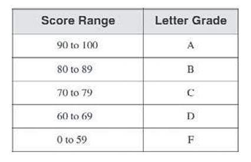
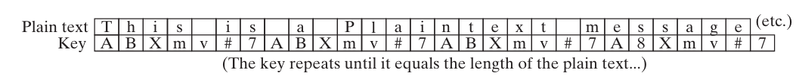
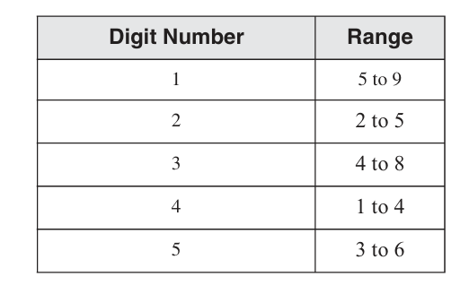

Review Questions and Exercises
==============================
1. What will be the value of BX after the following instructions execute?
```asm
mov  bx,0FFFFh
and  bx,6Bh
```
\-\> 006Bh

2. What will be the value of BX after the following instructions execute?
```asm
mov  bx,91BAh
and  bx,92h
```
\-\> 0092h

3. What will be the value of BX after the following instructions execute?
```asm
mov  bx,0649Bh
or   bx,3Ah
```
\-\> 64BBh

4. What will be the value of BX after the following instructions execute?
```asm
mov  bx,029D6h
xor  bx,8181h
```
\-\> A857h

5. What will be the value of EBX after the following instructions execute?
```asm
mov  ebx,0AFAF649Bh
or   ebx,3A219604h
```
\-\> BFAFF69Fh

6. What will be the value of RBX after the following instructions execute?
```asm
mov  rbx,0AFAF649Bh
xor  rbx,0FFFFFFFFh
```
\-\> FFFFFFFF50509B64h

7. In the following instruction sequence, show the resulting value of AL where indicated, in binary:
```asm
mov  al,01101111b
and  al,00101101b   ; a.
mov  al,6Dh
and  al,4Ah         ; b.
mov  al,00001111b
or   al,61h         ; c. 
mov  al,94h
xor  al,37h         ; d.
```
\-\> a = 00101101, b = 01001000, c = 01101111, d = 10100011


8. In the following instruction sequence, show the resulting value of AL where indicated, in
hexadecimal:
```asm
mov  al,7Ah
not  al             ; a.
mov  al,3Dh
and  al,74h         ; b.
mov  al,9Bh
or   al,35h         ; c.
mov  al,72h
xor  al,0DCh        ; d.
```
\-\>a = 85h b = 34h c = BFh d = AEh


9. In the following instruction sequence, show the values of the Carry, Zero, and Sign flags
where indicated:    
```asm
mov  al,00001111b
test al,00000010b       ; a. CF=   ZF=   SF=
mov  al,00000110b
cmp  al,00000101b       ; b. CF=   ZF=   SF=
mov  al,00000101b   
cmp  al,00000111b       ; c. CF=   ZF=   SF=
```
\-\> a = 0,0,0   b = 0,0,0   c = 1,0,1

10. Which conditional jump instruction executes a branch based on the contents of ECX?
\-\> JECXZ

11. How are JA and JNBE affected by the Zero and Carry flags?
\-\> CF=0, ZF=0

12. What will be the final value in EDX after this code executes?
```asm
    mov  edx,1
    mov  eax,7FFFh
    cmp  eax,8000h
    jl   L1
    mov  edx,0
L1:
```
\-\> 1

13. What will be the final value in EDX after this code executes?
```asm
    mov  edx,1
    mov  eax,7FFFh
    cmp  eax,8000h
    jb   L1
    mov  edx,0
L1:
```
\-\> 1


14. What will be the final value in EDX after this code executes?
```asm
    mov  edx,1
    mov  eax,7FFFh
    cmp  eax,0FFFF8000h
    jl   L2
    mov  edx,0
L2:
```
\-\> 0

15. (True/False): The following code will jump to the label named Target.
```asm
mov  eax,-30
cmp  eax,-50
jg   Target
```
\-\> True

16. (True/False): The following code will jump to the label named Target.
```asm
mov  eax,-42
cmp  eax,26
ja   Target
```
\-\> True

17. What will be the value of RBX after the following instructions execute?
```asm
mov  rbx,0FFFFFFFFFFFFFFFFh
and  rbx,80h
``` 
\-\>  0000000000000080h

18. What will be the value of RBX after the following instructions execute?
```asm
mov  rbx,0FFFFFFFFFFFFFFFFh
and  rbx,808080h
```
\-\> 0000000000808080h

19. What will be the value of RBX after the following instructions execute?
```asm
mov  rbx,0FFFFFFFFFFFFFFFFh
and  rbx,80808080h
```
\-\> FFFFFFFF80808080h

Algorithm Workbench
===================

1. Write a single instruction that converts an ASCII digit in AL to its corresponding binary
value. If AL already contains a binary value (00h to 09h), leave it unchanged.
```asm
and al, 0Fh
```
2. Write instructions that calculate the parity of a 32-bit memory operand. Hint: Use the for
mula presented earlier in this section: B0 XOR B1 XOR B2 XOR B3.
```asm
mov al, BYTE PTR mem
xor al, BYTE PTR mem+1
xor al, BYTE PTR mem+2
xor al, BYTE PTR mem+3
```

3. Given two bit-mapped sets named SetX and SetY, write a sequence of instructions that gen
erate a bit string in EAX that represents members in SetX that are not members of SetY.
```asm
mov eax, SetX
not eax
and eax, SetY
```

4. Write instructions that jump to label L1 when the unsigned integer in DX is less than or
equal to the integer in CX.
```asm
cmp DX,CX
jeb L1
```

5. Write instructions that jump to label L2 when the signed integer in AX is greater than the
integer in CX.
```asm
cmp AX,CX
jg L2
```

6. Write instructions that first clear bits 0 and 1 in AL. Then, if the destination operand is equal
to zero, the code should jump to label L3. Otherwise, it should jump to label L4.
```asm
and al, 11111100
jz L3
jmp L4
```

7. Implement the following pseudocode in assembly language. Use short-circuit evaluation
and assume that val1 and X are 32-bit variables.
```asm
if( val1 > ecx ) AND ( ecx > edx ) 
   X = 1
else
   X = 2;
```
\-\>
```asm
    mov eax, val1
    cmp val1, ecx
    jle ElsePart
    cmp ecx, edx
    jle ElsePart
    mov X,1
    jmp Done
ElsePart:
    mov X,2
Done:

```
8. Implement the following pseudocode in assembly language. Use short-circuit evaluation
and assume that X is a 32-bit variable.
```asm
if( ebx > ecx ) OR ( ebx > val1 ) 
   X = 1
else
   X = 2
```
\-\>
```asm
    cmp ebx, ecx
    jg ThenPart
    cmp ebx, val1
    jg ThenPart
    mov X, 2
    jmp Done
ThenPart:
    mov X,1
Done:

```
9. Implement the following pseudocode in assembly language. Use short-circuit evaluation
and assume that X is a 32-bit variable.
```asm
if( ebx > ecx AND ebx > edx) OR ( edx > eax ) 
   X = 1
else
   X = 2
```
\-\>
```asm
    cmp ebx,ecx
    jle CheckOr
    cmp ebx, edx
    jg ThenPart
CheckOr:
    cmp cdx, eax
    jg ThenPart
    mov X,2
    jmp Done
ThenPart:
    mov X,1
Done:

```
10. Implement the following pseudocode in assembly language. Use short-circuit evaluation
and assume that A, B, and N are 32-bit signed integers. 
```asm
while N > 0
  if N != 3 AND (N < A OR N > B)
  N = N – 2
  else
     N = N – 1
end whle
```
\-\>
```asm
WhileLoop:
    cmp N, 0
    jle EndWhile
    cmp N,3
    je Dec1
    mov eax,N
    cmp eax, A
    jg Dec2
    cmp eax, B
    jle Dec1
Dec1:
    dec N
    jmp WhileLoop
Dec2:
    sub N,2
    jmp WhileLoop
EndWhile:

```
Programming Exercises
=====================

1. Filling an Array
Create a procedure that fills an array of doublewords with N random integers, making sure the
values fall within the range j...k, inclusive. When calling the procedure, pass a pointer to the
array that will hold the data, pass N, and pass the values of j and k. Preserve all register values
between calls to the procedure. Write a test program that calls the procedure twice, using differ
ent values for j and k. Verify your results using a debugger.
\-\>
```asm
TITLE Filling an Array with Random Integers

INCLUDE Irvine32.inc

.data
array1 DWORD 10 DUP(?)    ; 10개 요소
array2 DWORD 20 DUP(?)    ; 20개 요소
array3 DWORD 15 DUP(?)    ; 15개 요소

.code
main PROC
    ; Test 1: 배열1, 10개, 범위 1~100
    lea esi, array1
    mov ecx, 10
    mov ebx, 1              ; j (하한)
    mov edx, 100            ; k (상한)
    call FillArray

    ; Test 2: 배열2, 20개, 범위 -50~50
    lea esi, array2
    mov ecx, 20
    mov ebx, -50
    mov edx, 50
    call FillArray

    ; Test 3: 배열3, 15개, 범위 1000~9999
    lea esi, array3
    mov ecx, 15
    mov ebx, 1000
    mov edx, 9999
    call FillArray

    exit
main ENDP

; ==========================================
; FillArray 프로시저
; ==========================================
; 입력:
;   ESI = 배열 포인터
;   ECX = 요소 개수 (N)
;   EBX = 하한 (j)
;   EDX = 상한 (k)
; 출력:
;   배열이 난수로 채워짐
; 보존: 모든 레지스터
; ==========================================

FillArray PROC
    push eax
    push ebx
    push ecx
    push edx
    push esi
    push edi

    mov edi, ecx            ; EDI = 요소 개수 저장
    mov eax, edx
    sub eax, ebx
    inc eax                 ; EAX = 범위 크기 (k - j + 1)

    mov ecx, edi            ; ECX = 반복 횟수

L1:
    mov ebx, edx
    sub ebx, eax
    inc ebx                 ; EBX = j 값 조정

    call RandomRange        ; EAX = 범위 내 난수
    mov [esi], eax          ; 배열에 저장
    add esi, 4              ; 다음 요소로 이동
    loop L1

    pop edi
    pop esi
    pop edx
    pop ecx
    pop ebx
    pop eax
    ret
FillArray ENDP

END main
```

2. Summing Array Elements in a Range
Create a procedure that returns the sum of all array elements falling within the range j...k (inclu
sive). Write a test program that calls the procedure twice, passing a pointer to a signed double
word array, the size of the array, and the values of j and k. Return the sum in the EAX register,
and preserve all other register values between calls to the procedure.
\-\>
```asm
TITLE Sum Array Elements in Range

INCLUDE Irvine32.inc

.data
signedArray SDWORD -100, -50, 0, 25, 50, 75, 100, 125, 150, 200
arraySize = LENGTHOF signedArray

.code
main PROC
    ; Test 1: 범위 0~100
    lea esi, signedArray
    mov ecx, arraySize
    mov ebx, 0              ; j (하한)
    mov edx, 100            ; k (상한)
    call SumInRange

    ; EAX = 0 + 25 + 50 + 75 + 100 = 250
    call DumpRegs

    ; Test 2: 범위 -100~0
    lea esi, signedArray
    mov ecx, arraySize
    mov ebx, -100
    mov edx, 0
    call SumInRange

    ; EAX = -100 + (-50) + 0 = -150
    call DumpRegs

    exit
main ENDP

; ==========================================
; SumInRange 프로시저
; ==========================================
; 입력:
;   ESI = 배열 포인터
;   ECX = 배열 크기
;   EBX = 하한 (j)
;   EDX = 상한 (k)
; 출력:
;   EAX = 범위 내 요소의 합
; 보존: EBX, ECX, EDX, ESI, EDI, EBP
; ==========================================

SumInRange PROC
    push ebx
    push ecx
    push edx
    push esi

    mov eax, 0              ; 합계 초기화
    mov ecx, ecx            ; 반복 횟수

L1:
    mov edx, [esi]          ; EDX = 배열 요소

    ; j <= 요소 <= k 범위 검사
    cmp edx, ebx            ; 하한 검사
    jl SkipElement

    cmp edx, [esp + 4]      ; 상한 검사 (스택의 EDX 값)
    jg SkipElement

    add eax, edx            ; 합계에 추가

SkipElement:
    add esi, 4              ; 다음 요소
    loop L1

    pop esi
    pop edx
    pop ecx
    pop ebx
    ret
SumInRange ENDP

END main
```

3. Test Score Evaluation
Create a procedure named CalcGrade that receives an integer value between 0 and 100, and
returns a single capital letter in the AL register. Preserve all other register values between calls
to the procedure. The letter returned by the procedure should be according to the following
ranges:

Write a test program that generates 10 random integers between 50 and 100, inclusive. Each
time an integer is generated, pass it to the CalcGrade procedure.  You can test your program
using a debugger, or if you prefer to use the book’s library, you can display each integer and its
corresponding letter grade. (The Irvine32 library is required for this solution program because it
uses the RandomRange procedure.)
\-\>
```asm
TITLE Test Score Evaluation

INCLUDE Irvine32.inc

.code
main PROC
    mov ecx, 10             ; 10번 반복

L1:
    ; 50~100 범위의 난수 생성
    mov eax, 50             ; 하한
    mov ebx, 51             ; 범위 (100-50+1)
    call RandomRange        ; EAX = 난수 (50~100)

    mov edx, eax            ; EDX에 점수 저장

    ; 성적 계산
    call CalcGrade          ; AL = 성적

    ; 점수와 성적 표시
    call WriteDec           ; 점수 출력
    mov al, ' '
    call WriteChar
    mov al, [ebp-4]         ; 성적 출력
    call WriteChar
    call Crlf

    loop L1

    exit
main ENDP

; ==========================================
; CalcGrade 프로시저
; ==========================================
; 입력:
;   EAX = 점수 (0~100)
; 출력:
;   AL = 성적 ('A', 'B', 'C', 'D', 'F')
; 보존: EBX, ECX, EDX, ESI, EDI, EBP
; ==========================================

CalcGrade PROC
    push ebx
    push ecx
    push edx

    mov ebx, eax            ; EBX = 점수

    ; 90 이상
    cmp ebx, 90
    jl CheckB
    mov al, 'A'
    jmp Done

CheckB:
    ; 80 이상 89 이하
    cmp ebx, 80
    jl CheckC
    mov al, 'B'
    jmp Done

CheckC:
    ; 70 이상 79 이하
    cmp ebx, 70
    jl CheckD
    mov al, 'C'
    jmp Done

CheckD:
    ; 60 이상 69 이하
    cmp ebx, 60
    jl CheckF
    mov al, 'D'
    jmp Done

CheckF:
    ; 0 이상 59 이하
    mov al, 'F'

Done:
    pop edx
    pop ecx
    pop ebx
    ret
CalcGrade ENDP

END main
```

4. College Registration
Using the College Registration example from Section 6.7.3 as a starting point, do the following:
• Recode the logic using CMP and conditional jump instructions (instead of the .IF and
.ELSEIF directives).
• Perform range checking on the credits value; it cannot be less than 1 or greater than 30. If an
invalid entry is discovered, display an appropriate error message. 
• Prompt the user for the grade average and credits values.
• Display a message that shows the outcome of the evaluation, such as “The student can regis
ter” or “The student cannot register”.
(The Irvine32 library is required for this solution program.)
\-\>
```asm
TITLE College Registration

INCLUDE Irvine32.inc

.data
prompt1 BYTE "Enter grade average: ", 0
prompt2 BYTE "Enter number of credits: ", 0
errorMsg BYTE "Error: Credits must be between 1 and 30", 0
canRegister BYTE "The student can register", 0
cannotRegister BYTE "The student cannot register", 0

.code
main PROC
    ; 평균 학점 입력
    lea edx, prompt1
    call WriteString
    call ReadInt            ; EAX = 평균 (0~100)
    mov ebx, eax            ; EBX = 평균 저장

    ; 학점 입력
    lea edx, prompt2
    call WriteString
    call ReadInt            ; EAX = 학점
    mov ecx, eax            ; ECX = 학점 저장

    ; 학점 범위 검사 (1~30)
    cmp ecx, 1
    jl InvalidCredits
    cmp ecx, 30
    jg InvalidCredits

    ; 평균 및 학점 검사
    call EvaluateRegistration

    jmp Done

InvalidCredits:
    lea edx, errorMsg
    call WriteString
    call Crlf

Done:
    exit
main ENDP

; ==========================================
; EvaluateRegistration 프로시저
; ==========================================
; 입력:
;   EBX = 평균 학점
;   ECX = 학점 수
; ==========================================

EvaluateRegistration PROC
    push eax
    push ebx
    push ecx

    ; 평균 >= 90 AND 학점 >= 12
    cmp ebx, 90
    jl CannotReg

    cmp ecx, 12
    jl CannotReg

    ; 등록 가능
    lea edx, canRegister
    call WriteString
    jmp RegDone

CannotReg:
    ; 등록 불가능
    lea edx, cannotRegister
    call WriteString

RegDone:
    call Crlf

    pop ecx
    pop ebx
    pop eax
    ret
EvaluateRegistration ENDP

END main
```
5. Boolean Calculator (1)
Create a program that functions as a simple boolean calculator for 32-bit integers. It should dis
play a menu that asks the user to make a selection from the following list:
```asm
1. x AND y
2. x OR y
3. NOT x
4. x XOR y
5. Exit program
```
When the user makes a choice, call a procedure that displays the name of the operation about to
be performed. You must implement this procedure using the Table-Driven Selection technique,
shown in Section 6.5.4. (You will implement the operations in Exercise 6.) (The Irvine32 library
is required for this solution program.)
\-\>
```asm
TITLE Boolean Calculator (1)

INCLUDE Irvine32.inc

.data
menuStr BYTE "Menu:", 0Dh, 0Ah
        BYTE "1. x AND y", 0Dh, 0Ah
        BYTE "2. x OR y", 0Dh, 0Ah
        BYTE "3. NOT x", 0Dh, 0Ah
        BYTE "4. x XOR y", 0Dh, 0Ah
        BYTE "5. Exit program", 0Dh, 0Ah
        BYTE "Enter your choice: ", 0

andStr BYTE "AND operation", 0
orStr BYTE "OR operation", 0
notStr BYTE "NOT operation", 0
xorStr BYTE "XOR operation", 0

; 테이블 기반 선택 (Table Driven Selection)
tableJump DWORD OFFSET AndProc
          DWORD OFFSET OrProc
          DWORD OFFSET NotProc
          DWORD OFFSET XorProc

.code
main PROC
L1:
    ; 메뉴 표시
    lea edx, menuStr
    call WriteString
    call ReadInt            ; EAX = 선택 (1~5)

    ; 유효성 검사
    cmp eax, 1
    jl L1
    cmp eax, 5
    jg L1

    ; 선택 5 = 종료
    cmp eax, 5
    je Exit

    ; 테이블 기반 분기
    dec eax                 ; 인덱스 조정 (0~3)
    shl eax, 2              ; 4바이트씩 오프셋
    mov eax, tableJump[eax]
    call eax                ; 해당 프로시저 호출

    jmp L1

Exit:
    exit
main ENDP

AndProc PROC
    lea edx, andStr
    call WriteString
    call Crlf
    ret
AndProc ENDP

OrProc PROC
    lea edx, orStr
    call WriteString
    call Crlf
    ret
OrProc ENDP

NotProc PROC
    lea edx, notStr
    call WriteString
    call Crlf
    ret
NotProc ENDP

XorProc PROC
    lea edx, xorStr
    call WriteString
    call Crlf
    ret
XorProc ENDP

END main
```

6. Boolean Calculator (2)
Continue the solution program from Exercise 5 by implementing the following procedures:
• AND_op: Prompt the user for two hexadecimal integers. AND them together and display the
result in hexadecimal.
• OR_op: Prompt the user for two hexadecimal integers. OR them together and display the
result in hexadecimal.
• NOT_op: Prompt the user for a hexadecimal integer. NOT the integer and display the result in
hexadecimal.
• XOR_op: Prompt the user for two hexadecimal integers. Exclusive-OR them together and
display the result in hexadecimal.
(The Irvine32 library is required for this solution program.)
\-\>
```asm
TITLE Boolean Calculator (2)

INCLUDE Irvine32.inc

.data
prompt1 BYTE "Enter first hexadecimal number: ", 0
prompt2 BYTE "Enter second hexadecimal number: ", 0
prompt3 BYTE "Enter hexadecimal number: ", 0
resultStr BYTE "Result: ", 0
andStr BYTE "AND operation", 0
orStr BYTE "OR operation", 0
notStr BYTE "NOT operation", 0
xorStr BYTE "XOR operation", 0

.code
main PROC
    ; (Exercise 5의 메뉴 로직)
    mov eax, 1              ; 테스트용 선택값

    ; AND 연산 테스트
    call AND_op

    ; OR 연산 테스트
    call OR_op

    ; NOT 연산 테스트
    call NOT_op

    ; XOR 연산 테스트
    call XOR_op

    exit
main ENDP

; ==========================================
; AND_op 프로시저
; ==========================================

AND_op PROC
    lea edx, andStr
    call WriteString
    call Crlf

    lea edx, prompt1
    call WriteString
    call ReadHex            ; EAX = 첫 번째 수
    mov ebx, eax

    lea edx, prompt2
    call WriteString
    call ReadHex            ; EAX = 두 번째 수

    and eax, ebx            ; EAX = 결과

    lea edx, resultStr
    call WriteString
    call WriteHex           ; 16진수로 출력
    call Crlf
    ret
AND_op ENDP

; ==========================================
; OR_op 프로시저
; ==========================================

OR_op PROC
    lea edx, orStr
    call WriteString
    call Crlf

    lea edx, prompt1
    call WriteString
    call ReadHex            ; EAX = 첫 번째 수
    mov ebx, eax

    lea edx, prompt2
    call WriteString
    call ReadHex            ; EAX = 두 번째 수

    or eax, ebx             ; EAX = 결과

    lea edx, resultStr
    call WriteString
    call WriteHex
    call Crlf
    ret
OR_op ENDP

; ==========================================
; NOT_op 프로시저
; ==========================================

NOT_op PROC
    lea edx, notStr
    call WriteString
    call Crlf

    lea edx, prompt3
    call WriteString
    call ReadHex            ; EAX = 입력

    not eax                 ; EAX = 결과

    lea edx, resultStr
    call WriteString
    call WriteHex
    call Crlf
    ret
NOT_op ENDP

; ==========================================
; XOR_op 프로시저
; ==========================================

XOR_op PROC
    lea edx, xorStr
    call WriteString
    call Crlf

    lea edx, prompt1
    call WriteString
    call ReadHex            ; EAX = 첫 번째 수
    mov ebx, eax

    lea edx, prompt2
    call WriteString
    call ReadHex            ; EAX = 두 번째 수

    xor eax, ebx            ; EAX = 결과

    lea edx, resultStr
    call WriteString
    call WriteHex
    call Crlf
    ret
XOR_op ENDP

END main
```

7. Probabilities and Colors
Write a program that randomly chooses among three different colors for displaying text on
the screen. Use a loop to display 20 lines of text, each with a randomly chosen color. The
probabilities for each color are to be as follows: white=30%, blue=10%, green=60%.
Suggestion: Generate a random integer between 0 and 9. If the resulting integer falls in the
range 0 to 2 (inclusive), choose white. If the integer equals 3, choose blue. If the integer falls in
the range 4 to 9 (inclusive), choose green. Test your program by running it ten times, each time
observing whether the distribution of line colors appears to match the required probabilities.
(The Irvine32 library is required for this solution program.)

8. Message Encryption
Revise the encryption program in Section 6.3.4 in the following manner: Create an encryption
key consisting of multiple characters. Use this key to encrypt and decrypt the plaintext by XOR
ing each character of the key against a corresponding byte in the message. Repeat the key as
many times as necessary until all plain text bytes are translated. Suppose, for example, the key
were equal to “ABXmv#7”. This is how the key would align with the plain text bytes:



9. Validating a PIN
Banks use a Personal Identification Number (PIN) to uniquely identify each customer. Let us
assume that our bank has a specified range of acceptable values for each digit in its customers’
5-digit PINs. The table shown below contains the acceptable ranges, where digits are numbered
from left to right in the PIN. Then we can see that the PIN 52413 is valid.  But the PIN 43534 is
invalid because the first digit is out of range. Similarly, 64535 is invalid because of its last digit.


Your task is to create a procedure named Validate_PIN that receives a pointer to an array of byte
containing a 5-digit PIN. Declare two arrays to hold the minimum and maximum range values,
and use these arrays to validate each digit of the PIN that was passed to the procedure. If any
digit is found to be outside its valid range, immediately return the digit’s position (between
1 and 5) in the EAX register. If the entire PIN is valid, return 0 in EAX. Preserve all other
register values between calls to the procedure. Write a test program that calls Validate_PIN at
least four times, using both valid and invalid byte arrays. By running the program in a debugger,
verify that the return value in EAX after each procedure call is valid. Or, if you prefer to use the
book’s library, you can display "Valid" or "Invalid" on the console after each procedure call.


10. Parity Checking
Data transmission systems and file subsystems often use a form of error detection that relies on
calculating the parity (even or odd) of blocks of data. Your task is to create a procedure that
returns True in the EAX register if the bytes in an array contain even parity, or False if the parity
is odd. In other words, if you count all the bits in the entire array, their count will be even or odd.
Preserve all other register values between calls to the procedure. Write a test program that calls
your procedure twice, each time passing it a pointer to an array and the length of the array. The
procedure’s return value in EAX should be 1 (True) or 0 (False). For test data, create two arrays
containing at least 10 bytes, one having even parity, and another having odd parity. 
